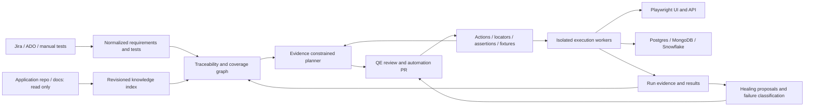

# SuperQ architecture

## Product goal and boundaries

Make QE intent executable and auditable across UI, API and data systems. SuperQ is an automation repository with read-only access to application source and documentation. Application code informs risk and test proposals; it never defines correctness by itself. Acceptance criteria, independent business oracles and QE review determine expected behavior.

“No hallucination” is an engineering aspiration, not a guarantee any model can satisfy. Unknown facts must produce questions or blocked drafts. Similarly, no coverage percentage proves the absence of defects. Report the denominator, evidence freshness and uncovered risks.

## Target system

The foundation represents these boundaries as TypeScript modules and a versioned JSON project. Production should separate control-plane services from isolated execution workers, with PostgreSQL metadata, encrypted object storage for artifacts and a durable job queue. Start with relational edges and full-text retrieval; add embeddings only if measured retrieval quality justifies cost. Do not introduce a graph database or multi-agent model loop by default.

## Data model

| Entity | Identity and relationships |
|---|---|
| Source evidence | Source URI/path + immutable revision + excerpt/hash; later add line spans and provenance signatures |
| Requirement | Stable tracker identity + revision + acceptance criterion + risk + evidence |
| Test | Stable ID, origin, review state, requirement links, steps, assertions, data, dependencies and blockers |
| Catalog action | Unique semantic operation, owned implementation, version and affected components |
| Locator | Owned page/component key, semantic selector, uniqueness evidence and revision |
| Run | Application SHA, automation SHA, environment, suite, data version, attempt, status and artifacts |
| Proposal | Evidence and catalog references, unknowns, candidate diff, review decisions and model provenance |

Today JSON IDs and references are validated. Ownership, immutable audit events and persistent run lineage are target capabilities, not yet implemented.

## Workflow

1. QE imports or authors tests against acceptance criteria. AI can propose additional boundary, negative, authorization, accessibility, contract and data scenarios, with evidence and questions.
2. Read committed application files under an explicit allowlist; identify changed contracts, endpoints, components and persistence rules. Store a source SHA and hashes.
3. Compare QE tests, AI drafts and automation. Treat origin separately from approval and execution state. Rank gaps by business risk, changed behavior, missing assertions and stale evidence.
4. Search the action and locator catalog before adding anything. Exact duplicate definitions fail validation; semantic duplicates require reviewer judgment and future AST-based analysis.
5. Generate a proposed automation diff using catalog IDs. Build, type-check, review and run against controlled environments. Unsupported steps remain blocked.
6. Schedule suite execution. Prefer independent fixtures and isolated test data. Explicit dependencies execute in order; failed setup creates a blocker, not an application failure for each descendant.
7. Attach sanitized evidence, classify failures, and propose repairs. Preserve the original failure and expected behavior. A repaired candidate never converts the original run to a pass.
8. QE accepts/rejects the proposal; approved examples improve retrieval and ranking. No online model training or silent code mutation.

## Healing and learning policy

Playwright's waiting and locator APIs handle timing and element targeting; semantic repair is separate. Prefer role/label/test-ID contracts. A repair candidate must identify one intended element, preserve assertions, include current evidence, and pass an isolated validation run. The current implementation only produces a review-required eligibility object; it neither discovers nor validates a replacement.

Never heal changed amounts, authorization outcomes, missing records, API contracts or business rules by editing expectations. Distinguish product regressions, changed specification, environment outages, flaky tests and test defects. Require owners, expiry dates and review for quarantines. Preserve failure history and measure recurrence rather than hiding flakes behind retries.

Learning means versioned accepted knowledge, reusable actions and feedback-driven retrieval, with provenance and rollback. It does not mean granting the model production access or automatically retraining on secrets.

## Cost design

Use deterministic schemas, hashing, catalog lookup and diffs before model calls. Index only changed approved files, retrieve only relevant evidence, cache by full request content and reject unsupported outputs. Route simple classification to a lower-cost model and ambiguous planning to a stronger model only when evaluation demonstrates value. Measure accepted useful tests per dollar, escaped defects, review time and flaky failure rate. Keep model choice configurable and validate it on your own application; no universal best model is assumed.

Current Planner bounds one in-process session. Production requires atomic persistent reservations across workers, provider-enforced token/cost ceilings, model/prompt versioned caches, tenant quotas and billing reconciliation. Database/warehouse spend also needs limits.

## Security and execution

Use separate identities for application-source reads, automation-repo writes, tracker reads, optional tracker publication and runtime environment access. Do not share an application write token with the planner. Keep secrets out of knowledge, prompts and artifacts. Treat repository files, issue descriptions and DOM text as untrusted input. Generated code runs only after review in an ephemeral worker with restricted network/filesystem access.

The local foundation is a trusted CLI, not a hardened multi-tenant service. Browser/API requests are restricted to the configured application origin; database adapters require server-enforced least privilege. Reports omit raw responses and exception details to reduce accidental secrets in output. Rich sanitized diagnostics, artifacts and worker containment are required before production rollout.

## Framework choices and references

- TypeScript gives one extension language for Playwright, API orchestration and data adapters.
- Playwright semantic locators and retrying assertions reduce brittle browser scripts: [locators](https://playwright.dev/docs/locators), [best practices](https://playwright.dev/docs/best-practices).
- Cucumber offers optional business-readable scenarios; do not force every technical assertion into Gherkin: [reference](https://cucumber.io/docs/gherkin/reference/).
- Tracker readers follow [Jira Cloud issue API](https://developer.atlassian.com/cloud/jira/platform/rest/v3/api-group-issues/) and [ADO work-item API](https://learn.microsoft.com/en-us/rest/api/azure/devops/wit/work-items/get-work-item?view=azure-devops-rest-7.1).
- Snowflake configuration must follow your account's authentication/warehouse policy: [driver options](https://docs.snowflake.com/en/developer-guide/node-js/nodejs-driver-options).
