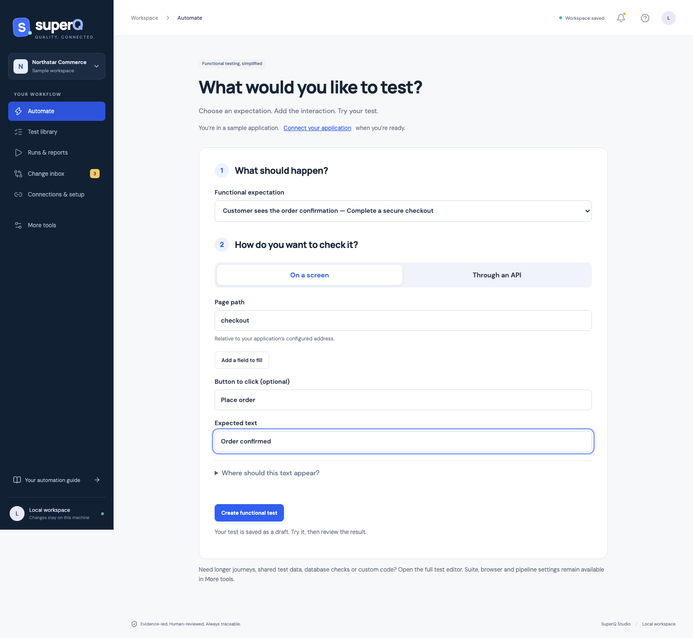

# SuperQ Studio: from first setup to maintenance

SuperQ Studio is a local, runnable React workspace connected to SuperQ's project model, coverage analysis, review digests and execution engine. It is the product's first guided UI. It is not a hosted multi-user service. Start with:

```sh
npm ci
npx playwright install chromium
npm run studio
```

Open `http://127.0.0.1:4310`. To serve built assets, run `npm run build` then `npm run studio:serve`. Override the port with `SUPERQ_PORT`. Private state, review history and run reports are saved under `.superq/workspace/`; they are Git-ignored. The server binds only to loopback. Stop it with Ctrl+C. A build requires Node.js 22.12+ (or a supported newer version) for Vite.

The default **Automate** page provides the shortest path for common functional checks. Choose an expectation, describe the interaction and try the test. Routine navigation stays compact; specialist screens are available under **More tools**. See [the simple workflow](easy-automation.md).



[Studio overview](images/studio-overview.png)

[Maintenance comparison](images/studio-maintenance.png) · [Visual test builder](images/studio-builder.png)

## Experience principles

- Start from a functional expectation and a useful working check; reveal specialist configuration only when needed.
- Keep business intent, acceptance criteria, evidence, actions and expected outcomes connected.
- Prefer visual forms for HTTP requests, browser steps and assertions, while preserving an inspectable JSON escape hatch.
- Show saved, loading, empty, validation-error and conflict states. Reject stale writes instead of overwriting newer work.
- Keep suggestions, staged drafts, human review and execution separate. Never equate a green count with production certification.
- Reveal technical detail when useful: full proposed definitions, source evidence, advanced inputs, report exports and immutable release identity.

The visual system uses a dark navigation rail, a quiet light workspace, blue primary actions, compact readable cards and restrained semantic colors. Layouts adapt to mobile navigation. Dialogs have labeled controls, keyboard focus handling, Escape dismissal and focus trapping. Reduced motion is supported. Browser tests check the rendered experience; this is not a claim of complete WCAG certification.

## The connected journey

| Step | User task | Working surface |
|---|---|---|
| Setup | Name the workspace; configure the app, evidence references and optional local source monitoring | Three-stage setup wizard; project import/export; environment and browser inspection |
| Requirements | Explain expected business behavior | Requirement authoring with risk, criteria and supporting source text |
| Test design | Turn criteria into clear cases | Search/filter library; visual test builder; traceability; suite/tags/dependencies/blockers |
| Automation | Reuse reliable behavior | Shared action and locator catalog; visual HTTP/browser inputs; independent assertions; advanced JSON and response capture |
| Review | Decide whether the saved case proves the intended behavior | Named local review attestation tied to current test/requirement/evidence content |
| Execute | Pick scope and target | Environment, suite, profile, parallel workers and optional focused test selection; cloud cost acknowledgment |
| Understand | Inspect results without hiding failures | Persistent run list; HTML report plus JSON/JUnit/Markdown exports through the server |
| Maintain | Understand a feature's impact | Change inbox with reasons, before/after validation/UI/workflow/functionality comparisons, evidence and full candidate definition |
| Recover | Undo an incorrect maintenance edit | Bounded project-version history; explicit restoration and source-impact re-evaluation |
| Release | Gather independent readiness evidence | Readiness checklist and export; protected CLI promotion workflow remains separate |

The built-in Northstar Commerce sample has real local API/browser endpoints and clearly labeled sample source changes. It lets users exercise the flow without connecting their application. Connections lists a sample version switch so assertions can be tested against sample v1 or v2; that switch never deploys an external application. Reference tests are not fake passing history: runs only appear after actual execution.

## Maintenance behavior

### Compare a known specification update

Export the current project, update its requirements/criteria, evidence, locator catalog and proposed test definitions, then choose **Compare versions** and upload that candidate. The core validator rejects broken references. The comparison identifies affected tests, direct evidence changes, shared locator/action changes and transitive dependents. It does not silently retire tests; an explicit project import is required for retirement in this version.

The change inbox presents:

- The exact reason the case was affected.
- Before/proposed expected results and request/browser interactions.
- Shared locator changes, with strategy/value differences.
- New functionality and acceptance criteria, plus original source excerpts.
- The full proposed test definition, so data/dependency/configuration changes are inspectable too.

**Stage suggested updates** applies only a selected proposal; **Stage all as drafts** handles a related group atomically. Shared source changes invalidate affected reviews. New acceptance criteria stay uncovered until a real test maps and asserts them. Staging never approves a test or changes the external application.

If a user edited a test after the comparison, automatic staging refuses to overwrite it. They can recompare or explicitly choose **Use my edited test**, record a reason, and stage the shared sources while preserving saved steps. That case still returns to draft. Reviews completed after the shared update are preserved when another proposal in the same batch is staged.

New requirements with no affected old cases can be staged separately and then appear as coverage gaps. Additional supplied candidate cases are imported as drafts. Saved passing results count as proof only while the current project fingerprint still matches their run context. Edited/re-reviewed tests need a fresh run. Changed source text alone cannot establish new business truth: users must interpret it before claiming coverage.

### Watch committed application changes

Setup can point to an existing local Git checkout with an explicit list of tracked source paths. The runtime uses read-only committed snapshots. With monitoring enabled it checks every 30 seconds while Studio runs; otherwise use **Check for changes**. The first check records a baseline. Later content changes or committed deletions produce notifications and source comparisons for evidence whose `source` exactly matches a monitored path. Mapped tests are set to draft and lose old review attestations.

Unknown or unmapped files are surfaced as unknown impact. They are not treated as covered. Generic code changes do not automatically generate assertions, infer design intent or rewrite locators. Add/maintain evidence mappings and provide an approved candidate or use local AI for a reviewable draft. Remote Git webhooks, authenticated Jira/ADO sync, AST-level impact analysis and unattended monitoring when the process is closed are not implemented by this UI.

Only one pending source comparison is retained at a time. New source revisions pause for review rather than replacing unresolved proposals. Multiple simultaneous scans are rejected. Review the next revision after the current comparison is resolved.

## Execution and AI boundaries

The run dialog can select an entire suite or a focused subset. Required dependencies are included by the runner. Pending maintenance blocks selected impacted cases; unaffected cases can still run. Focused runs are labeled partial and cannot authorize promotion. Drafts are skipped by default. An explicit exploratory draft-validation mode can execute saved draft definitions without approving them; it does not count as reviewed coverage or promotion evidence. Blocked cases remain visible in reports. The UI uses built-in adapters; arbitrary custom TypeScript execution stays in the programmatic API.

Remote profiles are used only when explicitly selected and acknowledged; credentials remain environment variables. The sample's loopback URL requires a correctly configured vendor tunnel for cloud use. No paid session is started by opening Studio or its setup screens.

**Draft with local AI** requires an installed model name, calls the existing bounded loopback Ollama adapter and shows a draft. It does not download models, auto-write tests or record approvals. Check the daemon's privacy configuration. Live inference quality remains unevaluated.

## Local security and current limits

Mutations require a per-process request token, reject cross-site requests, validate payloads and require a matching workspace revision. Host checks reject non-local hostnames. State writes are queued and atomically renamed. Project history is capped at 12 versions. This is a trusted single-user local tool: authenticated roles, signed approvals, multi-user storage, a hardened job queue and process isolation remain enterprise work.

Repository/tracker/documentation URLs in setup are labeled references or configured-but-unverified. They are not falsely presented as authenticated connections. Monitoring needs a local checkout and exact source path allowlist. The startup sample is visibly separate from live application evidence.

Current authoring is strongest for API and browser journeys. Database adapters are accessible through project definitions, and configurable cloud profiles are imported through project configuration. Native database/query designers, screenshot/visual-regression comparison, drag-and-drop ordering, integrated recorder, tracker synchronization and role-based team workflows remain next UX increments. Font delivery uses Google Fonts with system fallbacks; the tool remains usable without them.

## Environment and account setup

Environments & accounts is available in the normal navigation for one-time application configuration. It provides role definitions, environment-scoped accounts/defaults, separate web/API URLs, secret-name references, typed environment data and optional labeled form login. Automate and the full run dialog send an explicit account alias when selected; tests can declare role requirements or anonymous behavior. See [the environment guide](environments-and-accounts.md) for resolution rules and limits.
